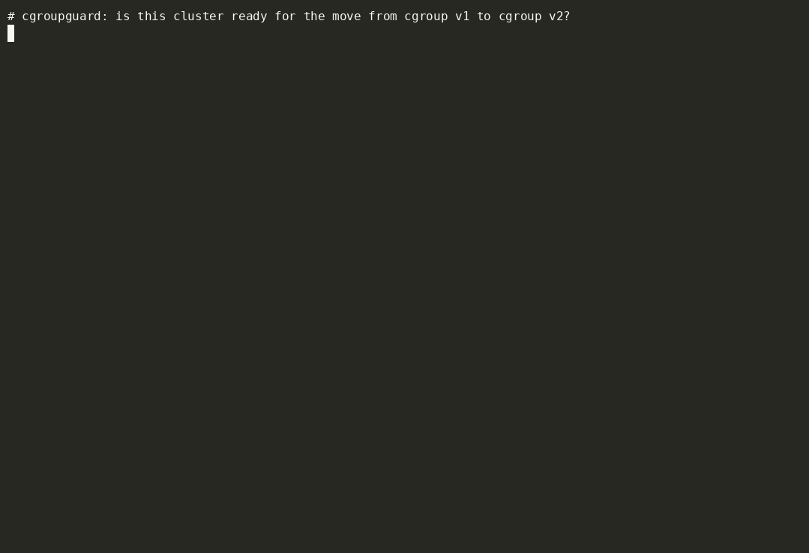

# cgroupguard

Evidence-based readiness checker for the Kubernetes move from **cgroup v1 to cgroup v2**.

From Kubernetes 1.35 the kubelet refuses to start on a cgroup v1 node by default, and cgroup v1 support is planned for removal.
cgroupguard tells you which nodes are still on cgroup v1 (or a hybrid layout), which workloads and agents are likely to break when their
node moves, how many pods are affected and how recoverable they are, and can write a reviewable migration plan (runbook, Terraform for
GKE/EKS/AKS, Ansible for self-managed nodes).

- **Read-only by default.** No permissions beyond reading nodes, pods and PodDisruptionBudgets; nothing is created unless you opt in.
- **Never certifies.** Output is advisory. Missing evidence is reported as *unknown*, never as *ready*.
- **Explains itself.** Every finding carries evidence, why it matters, blast radius, confidence and a primary source.
- **Remediation you can review.** `fix --plan` changes nothing; applying is a separate, confirmed, audited step.



## Install

Download a release archive, package, container image or Helm chart (see [docs/install.md](docs/install.md), including how to verify signatures),
or build from source with Go 1.27.2 or newer:

```sh
go build -o cgroupguard ./cmd/cgroupguard
```

## Use

```sh
cgroupguard check --context my-cluster            # scan nodes and workloads
cgroupguard check --input snapshot.json -o json   # scan a saved snapshot
cgroupguard fix --plan --context my-cluster       # write a remediation runbook, changing nothing
```

## Documentation

| | |
|---|---|
| [Quickstart](docs/quickstart.md) | five minutes, no cluster needed |
| [Install](docs/install.md) | every channel, and how to verify a download |
| [Scan a cluster](docs/guides/scan-a-cluster.md) | step by step, with the roles it needs |
| [Evidence sources](docs/guides/evidence-sources.md) | turn "unknown" nodes into measured ones |
| [CI gating](docs/guides/ci-gating.md) | exit codes, SARIF and ready-made pipeline files |
| [Plan a migration](docs/guides/plan-managed-clusters.md) | GKE, EKS, AKS and [self-managed nodes](docs/guides/plan-self-managed-nodes.md) |
| [Controller and monitoring](docs/guides/controller-and-monitoring.md) | in-cluster scans, metrics and alerts |
| [Rule catalogue](docs/reference/rules.md) | every finding explained |
| [Troubleshooting](docs/troubleshooting.md) | error messages and what to do |

Everything is indexed in [docs/README.md](docs/README.md).

## Status

Pre-1.0. Rules are versioned data with cited sources; runtimes without verified documentation are marked *review*, never pass or fail.
Managed-cloud (GKE, EKS, AKS) plans are generated from provider documentation and have not yet been run on those platforms.

## Using it? Tell us

cgroupguard sends no usage data, so we only learn that it helps if you say so.

- Tried it? Leave short [feedback](https://github.com/amitpatole/cgroupguard/issues/new?template=feedback.yml). It takes a minute.
- Found a bug or a wrong result? [Open an issue](https://github.com/amitpatole/cgroupguard/issues/new?template=bug_report.yml).
- Using it for real? Add yourself to [ADOPTERS.md](ADOPTERS.md) or post in the [Discussions](https://github.com/amitpatole/cgroupguard/discussions).

## License and citation

Apache License 2.0 (see [LICENSE](LICENSE)). Redistributions must keep the [NOTICE](NOTICE) file, which credits the author.
If you use cgroupguard in published work, please cite it using [CITATION.cff](CITATION.cff).
